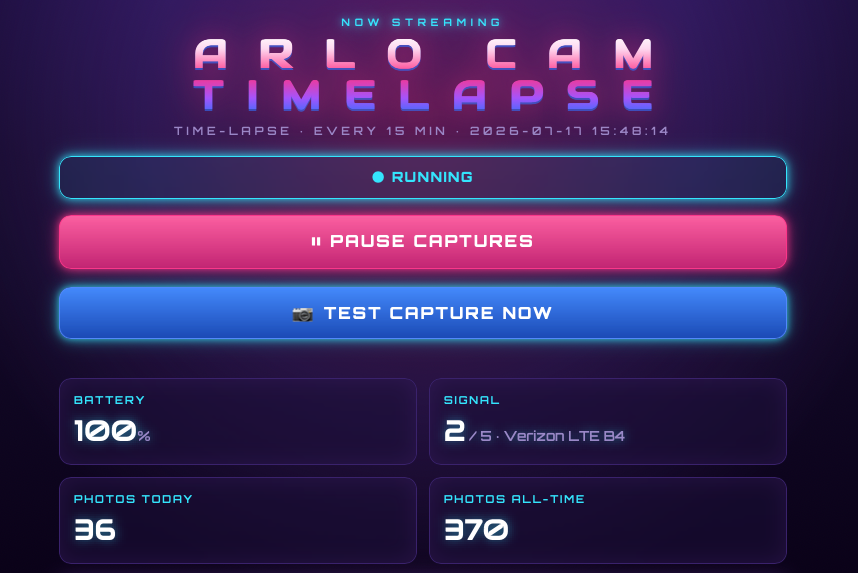

# 📸 Arlo Time Lapse Capture

Turn a single **Arlo Go 2** (cellular + solar) into a fully automated, **self-hosted
daylight time-lapse rig**. It grabs a fresh snapshot every few minutes while the sun
is up, saves the frames to *your own* server, keeps an eye on the battery, emails you
the moment anything breaks, and compiles the finished movie with one command — all
driven from a slick neon web dashboard that runs on UnRaid or any Docker host.

No third-party time-lapse service. No extra cloud subscription beyond Arlo itself.
Your images live on your hardware, under your control.

<p align="center">
  
  
  
  
  
</p>

<p align="center">
  
</p>

---

## ✨ Features

- **🌅 Daylight-only capture** — automatically tracks sunrise/sunset for your exact
  location (with a buffer), or pin it to fixed clock times. No wasted night frames.
- **🔋 Battery & signal aware** — logs battery/signal on every shot, warns you before
  it gets critical, and a one-tap **Pause/Resume** lets you nurse the battery on
  cloudy stretches without losing the session.
- **🖥️ Neon synthwave dashboard** — live battery, signal, photos-today/all-time, the
  latest frame, the capture window, and a recent-captures table. Mobile-friendly, with
  a proper app icon and link-preview share card.
- **⚙️ Edit everything from the browser** — interval, capture window, location, alert
  thresholds, email accounts, even the camera name — saved server-side, most applying
  instantly with no redeploy.
- **✏️ Make it yours** — a two-line **editable title** brands the page, browser tab,
  and link preview for your own build or site.
- **📜 Built-in log viewer** — view, copy, and clear the app log right from the page,
  plus a clickable version history.
- **📧 Alerts + daily digest** — instant emails on failures/low battery, and a sunset
  heartbeat email with the day's latest frame so silence always means "all good."
- **🎬 One-click video** — render the finished movie straight from the dashboard
  (pick FPS, date/time overlay, flicker smoothing, watch progress, download the MP4),
  or use the same ffmpeg compiler from the command line. The **de-flicker** filter
  smooths the Go 2's exposure jumps for buttery outdoor lapses.
- **🛡️ Resilient by design** — logs in to Arlo **once** and keeps the session alive
  (no repeated 2FA lockouts), survives reboots/crashes, and never lets a failed
  snapshot take down the daemon.

---

## Table of contents
1. [How it works (and why it's a daemon, not a cron job)](#1-how-it-works)
2. [What you need before you start](#2-what-you-need-before-you-start)
3. [Step A — Create a dedicated Arlo sub-account](#step-a--create-a-dedicated-arlo-sub-account)
4. [Step B — Create a dedicated Gmail + App Password](#step-b--create-a-dedicated-gmail--app-password)
5. [Step C — Fill in your `.env` file](#step-c--fill-in-your-env-file)
6. [Step D — One-time first-run login (2FA)](#step-d--one-time-first-run-login-2fa)
7. [Step E — Start the daemon](#step-e--start-the-daemon)
8. [Step F — Watch the logs and verify](#step-f--watch-the-logs-and-verify)
9. [Step G — Compile the final video](#step-g--compile-the-final-video)
10. [Adding it to UnRaid](#10-adding-it-to-unraid)
11. [All configuration options](#11-all-configuration-options)
12. [Troubleshooting](#12-troubleshooting)
13. [How the files fit together](#13-how-the-files-fit-together)

---

## 1. How it works

Every 15 minutes **during daylight only** (sunrise→sunset for your location, with
a buffer), the app asks the camera for a fresh snapshot through Arlo's cloud and
saves the JPEG to your server. It logs battery/signal on every attempt, emails
you immediately if something breaks, and sends a daily summary at sunset.

**Why a long-running daemon and not a cron job?** Arlo has no official API. We use
the community `pyaarlo` library, and Arlo expires login tokens about every 2 hours
and protects logins with email 2FA. If we logged in fresh every 15 minutes (like a
cron job would), Arlo would demand 2FA over and over and quickly **rate-limit or
lock the account**. So instead this is a single process that:

- logs in **once**,
- **saves the trusted session** to disk so restarts don't need 2FA again,
- **refreshes** the session in the background before the token expires, and
- fires captures from an **internal scheduler**.

A failed snapshot never crashes it — everything is wrapped in retries and logging.

---

## 2. What you need before you start

- An **UnRaid server** (or any always-on machine) with **Docker** + **Docker Compose**.
- Your Arlo Go 2 installed, online, solar-charged, on an active **Arlo Secure** plan.
- About 20 minutes to create the two dedicated accounts below.

> You will create **two dedicated accounts** so this automation never touches your
> personal Arlo or email logins. This is important: the tool reads the 2FA email
> and stays logged in continuously.

---

## Step A — Create a dedicated Arlo sub-account

1. In the **Arlo app**, go to **Settings → Grant Access** (sometimes "Family &
   Friends" / "Grant Access").
2. Add a new person using a **new email address** you control (e.g. a new Gmail —
   see Step B). Give them access to the bike-park camera.
3. Accept the invitation from that new email and **set a password** for the new
   Arlo login. Make sure the camera shows up and you can see a live view.
4. Confirm the camera's **exact name** in the app (e.g. `Bike Park`). You'll put
   this in `CAMERA_NAME`.

> Using a sub-account means this script logging in and out never disturbs your
> personal Arlo session on your phone.

---

## Step B — Create a dedicated Gmail + App Password

This single Gmail is used for **two** things: receiving the Arlo 2FA codes (read
over IMAP) and sending you alert/digest emails (over SMTP).

1. Create a **new Gmail account** (e.g. `bikepark.arlo@gmail.com`).
2. Turn on **2-Step Verification** for that Gmail:
   Google Account → **Security** → **2-Step Verification** → turn on.
3. Create an **App Password**:
   Google Account → **Security** → **App passwords** → create one (name it
   "arlo-timelapse"). Google shows a **16-character password** — copy it.
   You'll use this same value for **both** `IMAP_PASSWORD` and `SMTP_PASSWORD`.
4. Make sure **IMAP is enabled**: Gmail → **Settings (gear) → See all settings →
   Forwarding and POP/IMAP → Enable IMAP → Save**.
5. Set Arlo's 2FA to email this Gmail: in the **Arlo app**, sign in as the
   sub-account, go to 2-step/Multi-factor settings, and make **email to this
   Gmail** a trusted/primary method.

> Use the **App Password** everywhere a password is asked for — NOT the normal
> Gmail password. Regular passwords won't work for IMAP/SMTP once 2-Step is on.

---

## Step C — Fill in your `.env` file

From inside the project folder:

```
cp .env.example .env
```

Then open `.env` in a text editor and fill in the values. At minimum you must set:
`ARLO_USERNAME`, `ARLO_PASSWORD`, `CAMERA_NAME`, `IMAP_USERNAME`, `IMAP_PASSWORD`,
`SMTP_USERNAME`, `SMTP_PASSWORD`, `ALERT_EMAIL`, and `DATA_PATH`. Every option is
explained in [section 11](#11-all-configuration-options).

> `DATA_PATH` is the folder **on your UnRaid server** where snapshots/logs/video
> are written. Point it at a dedicated share you can browse from your Mac over SMB,
> e.g. `DATA_PATH=/mnt/user/arlo-timelapse`.

---

## Step D — One-time first-run login (2FA)

This establishes the trusted session once. Because we read the 2FA code from Gmail
automatically, this usually "just works" with no typing.

```
docker compose run --rm -it arlo-timelapse python login_once.py
```

You should see it log in and print the camera name. The session is saved under
`DATA_PATH/state`, so from now on the daemon starts headless without 2FA.

> If the automatic IMAP read fails, the script falls back to asking you to paste
> the code — check the dedicated Gmail inbox for the Arlo code and type it in.

---

## Step E — Start the daemon

```
docker compose up -d
```

`-d` means "detached" (runs in the background). It will keep running and restart
itself automatically after reboots or crashes.

---

## Step F — Watch the logs and verify

Watch live activity:

```
docker compose logs -f
```

(Press `Ctrl+C` to stop watching — this does **not** stop the container.)

Within the daylight window you should, within ~15 minutes, see a line like
`Saved snapshot /data/snapshots/2025-07-01/arlo_20250701_091500.jpg`. Then verify:

- A dated folder with JPEGs appears under your `DATA_PATH/snapshots/`.
- `DATA_PATH/logs/status.csv` is gaining rows.
- `DATA_PATH/snapshots/latest.jpg` shows the most recent frame.
- You receive a **daily digest email** at sunset. If that email ever stops
  arriving, treat it as a warning that something is wrong.

---

## Step F2 — The web dashboard (battery, signal, photos + Pause button)

The daemon serves a small web page on your network so you can check on the
camera and **pause/resume captures** without touching the command line. Open it
in any browser (phone or computer) on the same network:

```
http://<your-unraid-host>:8080
```

(e.g. `http://tower:8080` or `http://192.168.1.50:8080`. Change the port with
`WEB_PORT` in `.env` if 8080 is taken.)

The page shows live **battery %** and **signal**, **photos today** and
**all-time**, the **latest snapshot**, the capture window, and a table of recent
captures. It auto-refreshes every 30 seconds. (The look is an 80s "synthwave"
theme — neon grid and all.)

**Pause** stops new snapshots (handy when the battery is low) while keeping the
camera logged in and the daily heartbeat email running — so a paused day shows
"0 frames" but is clearly labelled `[PAUSED]` in the email, not a failure.
Pressing **Resume** starts captures again.

### Changing settings from the dashboard

Tap **⚙ Settings** to change *any* setting from the browser — photo interval,
camera name, the capture window (sunrise/sunset **or** fixed start/end times),
location, alert thresholds, the daily-digest time, email accounts, and more.

* Changes are saved to **`/data/state/settings.json`** and quietly override the
  matching value from `.env`. They **survive a restart**.
* Most changes apply **immediately** (the daemon re-reads them and even
  re-schedules the capture job live). A few — the time zone and the Arlo/IMAP
  login details — are marked **`restart`** in the form and only take effect after
  the container restarts.
* The **dashboard port** is intentionally *not* in the UI: it's set by
  `WEB_PORT` in `.env` (compose publishes that port), so changing it lives there.
* **Passwords** are never shown in the page. Leave a password field blank to keep
  the current one; type a new value only to change it.
* To revert a setting to its `.env`/default value, clear the field and save.

If you ever want to wipe all your UI changes and go back to the `.env` values,
delete that one file:

```
ssh unraid "rm -f /mnt/user/arlo-timelapse/state/settings.json"
```

### Title, logs & version

* **✏️ Title** — set the two title lines under **⚙ Settings** to brand the page for
  your own build. It updates the big heading, the browser tab, and the link-preview
  card; saving reloads the page so the new title appears right away.
* **📜 Logs** — the **Logs** panel at the bottom streams the live application log.
  **Refresh** pulls the latest, **Copy** grabs it for a bug report, and **Clear**
  wipes the log + its backups.
* **ⓘ Version** — the version number at the very bottom opens a **what's-new** history.

> ⚠️ **Keep it on your home LAN.** The dashboard has **no password** (same as the
> Pause button always has), and the Settings panel can now change credentials.
> Don't port-forward `WEB_PORT` to the public internet. Anyone who can reach the
> page can change your settings.

Under the hood, pausing just creates the file `/data/state/paused.flag`. It
**survives a container restart**, and if the web page is ever unreachable you can
pause/resume by hand:

```
ssh unraid "touch /mnt/user/arlo-timelapse/state/paused.flag"   # pause
```
```
ssh unraid "rm -f /mnt/user/arlo-timelapse/state/paused.flag"   # resume
```

---

## Step G — Compile the final video

**The easy way:** open the dashboard, scroll to **Time-lapse video**, choose your
options (FPS, date/time overlay, flicker smoothing) and hit **🎬 Build video**. It
renders in the background, shows progress, and gives you a **Download** link for the
finished MP4 (also saved to `DATA_PATH/output/`). The command-line options below do
exactly the same thing if you prefer the terminal or want the full set of flags.

When the project is done (or any time you want a preview), run the compiler. It
prints the resulting video length first, then renders.

Simplest (all frames, 30 fps):

```
docker compose run --rm arlo-timelapse python compile.py
```

Recommended for an outdoor lapse (overlay date/time + smooth the exposure flicker):

```
docker compose run --rm arlo-timelapse python compile.py --overlay --deflicker 10
```

Just preview how long it would be, without rendering:

```
docker compose run --rm arlo-timelapse python compile.py --dry-run
```

A specific date range, scaled to 1080p:

```
docker compose run --rm arlo-timelapse python compile.py --from 2025-07-01 --to 2025-08-31 --scale 1920:-2
```

The finished `.mp4` lands in `DATA_PATH/output/`. All options:

| Option | Default | Meaning |
|---|---|---|
| `--src PATH` | `/data/snapshots` | Where to read frames from (searched recursively). |
| `--out FILE` | `/data/output/timelapse_<timestamp>.mp4` | Output file. |
| `--fps N` | `30` | Frames per second. Higher = shorter, smoother video. |
| `--scale WxH` | original | ffmpeg scale, e.g. `1920:-2` (width 1920, auto height). |
| `--from DATE` | all | Start date `YYYY-MM-DD` (inclusive). |
| `--to DATE` | all | End date `YYYY-MM-DD` (inclusive). |
| `--overlay` | off | Burn each frame's real date/time (from its filename) onto the image. |
| `--deflicker [N]` | off (N=10) | Smooth auto-exposure brightness jumps over N frames. |
| `--crf N` | `18` | Quality, 0–51, lower = better/larger. |
| `--dry-run` | off | Print frame count + length, don't render. |

> **About `--deflicker`:** the Go 2 auto-adjusts exposure between shots, so an
> outdoor lapse often "flickers" as brightness jumps frame to frame. The deflicker
> filter averages brightness across a small window of frames to smooth this out —
> it's the single biggest quality win for this kind of footage. Start with `10`;
> raise it if flicker remains, lower it if motion looks "ghosted".

---

## 10. Adding it to UnRaid

**Option 1 — Docker Compose Manager (recommended):**
1. In UnRaid, install **Compose Manager** from Community Applications.
2. Copy this whole project folder onto the server (e.g. to `/boot/config/plugins/compose/arlo-timelapse/` or any share).
3. In Compose Manager, **Add New Stack**, point it at this folder's `docker-compose.yml`, and make sure your filled-in `.env` sits next to it.
4. Set `DATA_PATH` in `.env` to a real UnRaid share path, then **Compose Up**.

**Option 2 — Command line on the server:**
```
cd /mnt/user/appdata/arlo-timelapse-src
docker compose up -d
```

**Watching logs on UnRaid:** either `docker compose logs -f` from the folder, or
the Docker tab → click the container icon → **Logs**.

> Make sure `DATA_PATH` points at a path that actually exists on the server. If you
> want to browse the snapshots from your Mac, use a user share (e.g.
> `/mnt/user/arlo-timelapse`) and enable SMB on it.

---

## 11. All configuration options

Everything is set in `.env`. **Required** values have no safe default.

| Variable | Required? | Default | What it does |
|---|---|---|---|
| `ARLO_USERNAME` | ✅ | — | Dedicated Arlo sub-account email. |
| `ARLO_PASSWORD` | ✅ | — | That sub-account's password. |
| `CAMERA_NAME` | ✅ | — | Camera name **exactly** as shown in the Arlo app. |
| `IMAP_USERNAME` | ✅ | — | Dedicated Gmail address (reads the 2FA code). |
| `IMAP_PASSWORD` | ✅ | — | Gmail **App Password** (16 chars). |
| `SITE_TITLE_LINE1` | | `MY TIME` | Top line of the big dashboard title (also the browser tab + link preview). |
| `SITE_TITLE_LINE2` | | `LAPSE` | Bottom line of the title. Leave blank for a single-line title. |
| `IMAP_HOST` | | `imap.gmail.com` | IMAP server. |
| `SMTP_USERNAME` | ✅ | — | Gmail address used to send mail. |
| `SMTP_PASSWORD` | ✅ | — | Gmail **App Password** (same 16 chars). |
| `SMTP_HOST` | | `smtp.gmail.com` | SMTP server. |
| `SMTP_PORT` | | `465` | `465`=SSL, `587`=STARTTLS. |
| `ALERT_EMAIL` | ✅ | — | Where alerts + digests are sent (your normal email). |
| `FROM_EMAIL` | | = `SMTP_USERNAME` | "From" address on outgoing mail. |
| `CAPTURE_INTERVAL_MIN` | | `15` | Minutes between snapshots. |
| `SNAPSHOT_TIMEOUT_SEC` | | `60` | How long to wait for each snapshot (LTE can be slow). |
| `CAPTURE_RETRIES` | | `3` | Retries per snapshot before counting it failed. |
| `LATITUDE` | | `42.360` | For sunrise/sunset — **set to your location** (default is a placeholder). |
| `LONGITUDE` | | `-71.059` | For sunrise/sunset — **set to your location**. |
| `DAYLIGHT_BUFFER_MIN` | | `30` | Start this many min after sunrise, stop this many before sunset. |
| `CAPTURE_START` | | — | Optional fixed start `HH:MM`. Set **both** start+end to ignore the sun. |
| `CAPTURE_END` | | — | Optional fixed end `HH:MM`. |
| `TZ` | | `America/New_York` | Timezone for scheduling + logs. |
| `BATTERY_ALERT_PCT` | | `20` | Email when battery drops below this %. |
| `CONSECUTIVE_FAIL_ALERT` | | `3` | Email after this many failed snapshots in a row. |
| `ALERT_COOLDOWN_HOURS` | | `6` | Minimum hours between repeats of the same alert. |
| `DAILY_DIGEST_TIME` | | `sunset` | `sunset` or a fixed `HH:MM`. |
| `RECONNECT_EVERY_MIN` | | `90` | Refresh the Arlo session this often (inside the ~2h window). |
| `LOG_LEVEL` | | `INFO` | `DEBUG` for very verbose logs. |
| `WEB_PORT` | | `8080` | Port for the local web dashboard (battery/signal/photos + Pause). |
| `DATA_PATH` | | `/mnt/user/appdata/arlo-timelapse` | **Host** folder mapped to `/data`. |

---

## 12. Troubleshooting

**Login fails / keeps asking for 2FA.**
- Re-run `login_once.py` (Step D) to re-establish the trusted session.
- Confirm IMAP is enabled in Gmail and you're using the **App Password**, not the
  normal password.
- Make sure Arlo's 2FA for the sub-account is set to **email** to the dedicated Gmail.
- Confirm `DATA_PATH/state` persists between restarts (it must be on the mounted volume).

**`pyaarlo` login breaks after working fine (Arlo changed something).**
- Edit `requirements.txt` and change `pyaarlo==0.8.0.21` to `0.8.0.20`, then to
  `0.8.0.14` if needed. Rebuild:
  ```
  docker compose build --no-cache
  ```
  ```
  docker compose up -d
  ```

**No snapshots are being saved.**
- It only captures during daylight (sunrise+buffer → sunset−buffer). Check the
  clock/`TZ` and `DAYLIGHT_BUFFER_MIN`.
- Watch `docker compose logs -f` for the reason (offline? snapshot timeout?).
- The Go 2 over LTE can be slow — try raising `SNAPSHOT_TIMEOUT_SEC`.

**Too many emails.** Raise `ALERT_COOLDOWN_HOURS`. The daily digest is never throttled.

**Battery keeps dropping (even while paused).** Pausing only stops *this app's*
snapshots — it does **not** change what the camera does on its own. The biggest
hidden drain is usually **motion recording**: if the camera is **armed** in the Arlo
app, it records and uploads clips over LTE all day (a busy outdoor scene means
near-constant motion), and pausing the time-lapse can't help that. Fixes, in order
of impact:
- Set the camera to **Disarmed** (or a custom mode with **no** motion-recording
  rules) in the **Arlo app**. On-demand snapshots still work while disarmed, so the
  time-lapse keeps running.
- Check the **signal** on the dashboard — `1/5` is very weak, and a weak signal makes
  every radio operation expensive. Improve placement or add an external antenna.
- Make sure the **solar panel** is unshaded, clean, and well-angled, and its cable is
  seated.
- Raise `CAPTURE_INTERVAL_MIN` (e.g. to `30`) so there are fewer snapshots.

**Camera not found.** The log prints the list of camera names it can see — set
`CAMERA_NAME` to match one exactly (including capitalization and spaces).

---

## 13. How the files fit together

```
.
├─ app/
│  ├─ config.py         # reads & validates all settings from environment variables
│  ├─ logging_setup.py  # logs to stdout + a rotating file in /data/logs
│  ├─ daylight.py       # sunrise/sunset window (astral)
│  ├─ arlo_client.py    # logs in, keeps the session, fetches snapshots (pyaarlo)
│  ├─ notify.py         # sends alert emails + the daily digest (SMTP)
│  ├─ capture.py        # one capture cycle: snapshot → save → status.csv → alerts
│  ├─ pause.py          # the pause flag file (shared by capture + dashboard)
│  ├─ webserver.py      # the local web dashboard (stdlib only): status + Pause + logs + video
│  ├─ builder.py        # runs compile.py in the background for the dashboard's Build button
│  ├─ version.py        # app version number + the dashboard's change history
│  └─ daemon.py         # the always-on process: login once + web + scheduler
├─ login_once.py        # run once to establish the trusted 2FA session
├─ compile.py           # build the final MP4 with ffmpeg (run on demand)
├─ requirements.txt     # pinned Python dependencies
├─ Dockerfile           # builds the image (Python + ffmpeg)
├─ docker-compose.yml   # how to run the container on UnRaid
├─ .env.example         # template for your settings (copy to .env)
└─ data/ (created at runtime, on your UnRaid share)
   ├─ snapshots/YYYY-MM-DD/arlo_*.jpg   # the captured frames
   ├─ snapshots/latest.jpg              # most recent frame (quick check)
   ├─ logs/app.log                      # rotating application log
   ├─ logs/status.csv                   # per-attempt battery/signal/success
   ├─ state/                            # saved Arlo session (skips repeat 2FA)
   │  ├─ paused.flag                    # present only while captures are paused
   │  └─ settings.json                  # settings changed from the dashboard UI
   └─ output/                           # compiled videos
```

---

## ⚖️ Disclaimer & credits

- **Not affiliated** with, endorsed by, or sponsored by Arlo. "Arlo" and "Go 2" are
  trademarks of their respective owners; this is an independent hobby project.
- It talks to Arlo through the excellent community library
  **[pyaarlo](https://github.com/twrecked/pyaarlo)**. There is **no official Arlo
  API**, so a future Arlo change can break logins — see
  [Troubleshooting](#12-troubleshooting) for the version-fallback trick. Always run
  it against a **dedicated sub-account**, never your primary Arlo login.
- Self-hosted and offline by design: your frames never leave your server.
- Provided **as-is, with no warranty**, under the **[MIT License](LICENSE)** — use
  it, fork it, adapt it for your own camera and location.

---

Enjoy your time-lapse! 🚵
